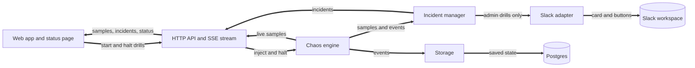

# Shadow-Pager

An incident simulation engine written in Go: inject a fake infrastructure failure, watch the incident run its course in Slack, and see the telemetry live on a status page.

| Dashboard | Status page | API |
|-----------|-------------|-----|
| [shadow-pager.vercel.app](https://shadow-pager.vercel.app) | [shadow-pager.vercel.app/status](https://shadow-pager.vercel.app/status) | [shadow-pager-api.onrender.com/api/v1/status](https://shadow-pager-api.onrender.com/api/v1/status) |

The API runs on a free plan that sleeps when idle, so the first load can take up to a minute.

## What it does

1. You start a drill: a service, a failure mode, a severity, an intensity and a duration.
2. The engine makes live metrics for it, and the first one that breaks an SLO declares an incident.
3. The incident is worked in Slack and shown on a dashboard and a public status page.

## Live demo

Anyone can start a **public drill** from the dashboard without a token. It runs, breaks
its SLO and declares an incident like any other, is tagged "public drill", and never
posts to Slack. A drill started with the admin token is an **admin drill**, which also
runs the Slack side: a channel per incident, an incident card with buttons, and a
timeline. The Slack workspace of the demo is private, so this recording shows it.

## Architecture

Slack and Postgres are both optional. Without them the server runs in memory and still
declares incidents.

## Go design decisions

| Decision | Record |
|----------|--------|
| Interfaces are declared by the package that uses them | [ADR 1](docs/adr/0001-consumer-side-interfaces.md) |
| Server-Sent Events for the dashboard, not WebSockets | [ADR 2](docs/adr/0002-sse-over-websockets.md) |
| Broadcast never blocks and slow subscribers drop samples | [ADR 3](docs/adr/0003-non-blocking-broadcast.md) |
| Shutdown drains HTTP before it stops the engine | [ADR 4](docs/adr/0004-shutdown-ordering.md) |
| A pgx exec mode that works behind transaction poolers | [ADR 5](docs/adr/0005-pooler-safe-pgx-exec-mode.md) |
| Readiness reads a remembered ping, so Neon can sleep | [ADR 6](docs/adr/0006-passive-readiness.md) |
| Persistence is driven by events, not by calls in the engine | [ADR 7](docs/adr/0007-events-drive-persistence.md) |
| The rate limiter and CORS are written by hand | [ADR 8](docs/adr/0008-hand-written-rate-limiter-and-cors.md) |
| Slack and storage are optional | [ADR 9](docs/adr/0009-optional-slack-and-storage.md) |

## Quick start

Requires Go 1.25 or newer and Node 20.19 or newer. No Slack workspace and no database
are needed.

    go run ./cmd/server                      # the API on http://localhost:8080

    cd web && npm install && npm run dev     # the web app on http://localhost:5173

## Testing

    go vet ./... && go test -count=1 ./...                            # or: make test
    cd web && npm run typecheck && npm run lint && npm test && npm run build
    go test -run '^$' -bench . -benchmem ./internal/chaos ./internal/ratelimit

Benchmark headline: a broadcast to 100 subscribers takes about 2.7 microseconds and
allocates nothing (12th generation Core i5). CI runs the Go tests with the race detector,
`govulncheck` and `npm audit` on every push.

## Documentation

- [Deploying](docs/deploy.md): Neon, Render, Vercel, Slack setup and the smoke test.
- [Configuration](docs/configuration.md): how it works, every endpoint and every environment variable.
- [Security](docs/security.md): API protection, dependencies and how secrets are handled.
- [Reporting a vulnerability](SECURITY.md): private reporting, scope and accepted risks.
- [Decision records](docs/adr/README.md): the nine design decisions in full.
- [Changelog](CHANGELOG.md) and [license](LICENSE) (MIT).
